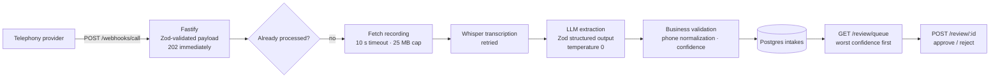

# Voice AI Intake

**A TypeScript service that turns recorded phone calls into structured intake records: a telephony webhook triggers Whisper transcription, an LLM extracts fields into a strict Zod schema, business validation scores confidence, and low-confidence calls rise to the top of a human review queue.**

Phone intake (service calls, appointment requests, support lines) produces messy audio and inconsistent notes. This pipeline captures who called, how to reach them, why, how urgent it is, and when they're available — while being explicit about what the model *didn't* hear, keeping PII out of logs, and routing doubtful extractions to a person.



## How it works

- **Untrusted input is parsed, not assumed.** The webhook body must match a Zod schema (`call.completed`, call ID, numbers, recording URL, duration); anything else is a `400`. Processing happens after the `202` response so the provider never waits on transcription.
- **Bounded downloads.** Recordings are fetched with a 10-second abort timeout and rejected above 25 MB, Whisper's per-request limit.
- **The model may say "not stated."** Every extracted field (`full_name`, `callback_number`, `reason`, `urgency` low/medium/high, `preferred_time`) is nullable, and the prompt forbids guessing. Output uses OpenAI structured outputs with the Zod schema and is parsed again on receipt.
- **Schema-valid isn't business-valid.** Phone numbers are normalized to 10 North American digits; missing names or reasons and unusable numbers become recorded issues, and each issue lowers the confidence score.
- **Review where it matters.** The queue lists pending intakes by lowest confidence, then oldest. Resolving only succeeds on a still-pending row, so two reviewers can't both close the same item (`409` otherwise).
- **Guardrails.** An early idempotency check skips calls already stored (with a `UNIQUE (call_id)` constraint as the backstop), transient model failures retry with exponential backoff (200/400/800 ms), and logged transcript snippets have phone-number and email spans redacted.
- **Measured extraction quality.** `eval/run-eval.ts` runs a labeled gold set through extraction and validation and reports per-field accuracy, printing every miss. Null-vs-null counts as correct (a justified abstention), and `reason` is matched by substring.

## API

| Method | Path | Description |
|---|---|---|
| `POST` | `/webhooks/call` | Telephony `call.completed` event → `202` |
| `GET` | `/review/queue` | Up to 20 pending intakes, lowest confidence first |
| `POST` | `/review/:id` | `{"outcome": "approved" \| "rejected"}` |
| `GET` | `/healthz` | Liveness probe |

Configuration: `DATABASE_URL`, `OPENAI_API_KEY`, `PORT` (default 8080). See [RUNBOOK.md](RUNBOOK.md) for deployment and operating signals.

## Running

The repository doesn't include a `package.json` yet. The sources type-check under TypeScript strict mode with these dependencies:

```bash
git clone https://github.com/AliAzamat/voice-ai-intake-system.git
cd voice-ai-intake-system
npm init -y
npm i fastify zod@3 openai pg
npm i -D typescript @types/node @types/pg tsx

psql "$DATABASE_URL" -f db/schema.sql
export OPENAI_API_KEY=<your key>
npx tsx src/index.ts

npx tsx eval/run-eval.ts     # field accuracy on eval/gold.json
```

## Limitations

- **Webhook requests aren't authenticated.** There's no provider signature check, so anyone who can reach the endpoint can submit calls.
- Processing runs in-process after the response; a restart loses in-flight jobs, and two simultaneous deliveries of the same call may both transcribe before the database constraint deduplicates them.
